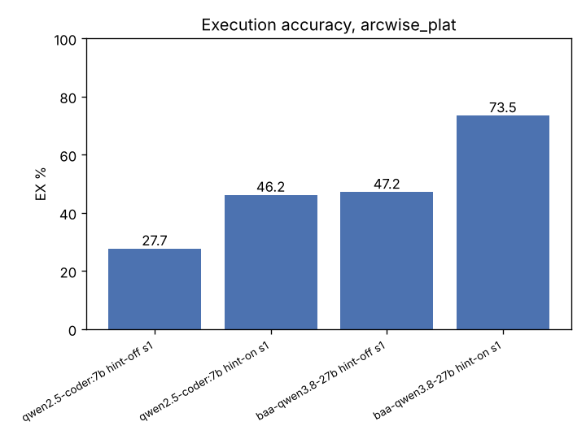
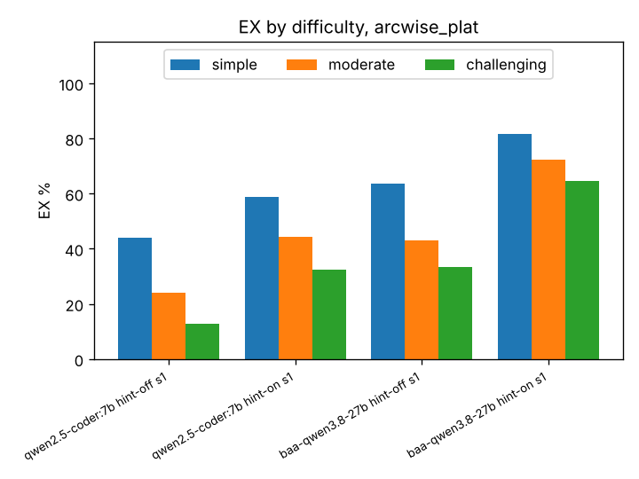
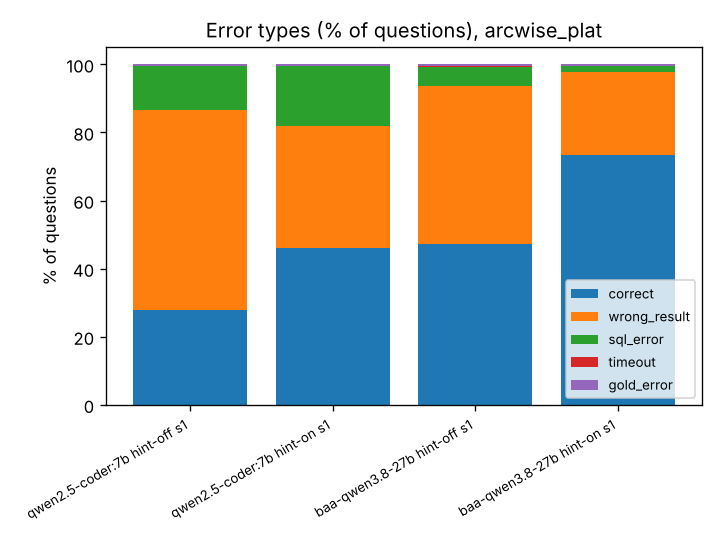
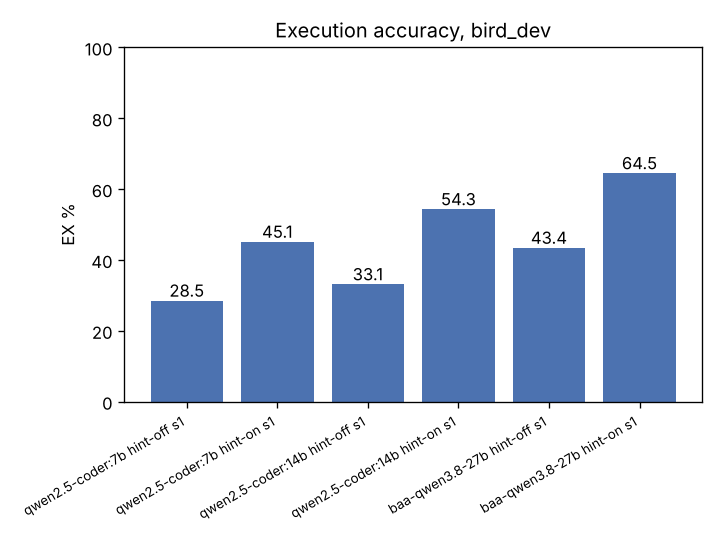
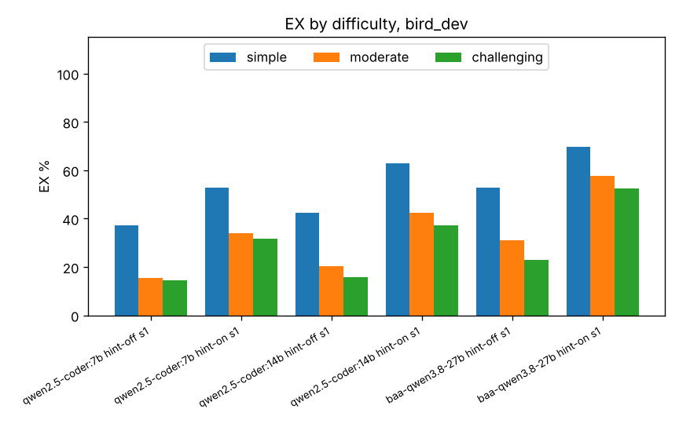
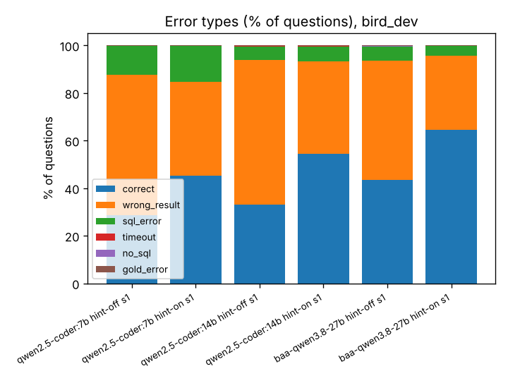
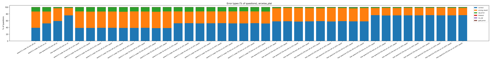
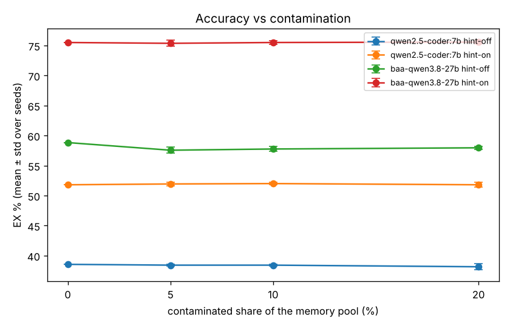

# BAA results: Robust Retrieval-Augmented Text-to-SQL with Locally Deployable Open-Weight Models

Generated 2026-11-04 09:14 from `results/` (90 experiments). Rows marked **running** are partial: their numbers cover only the questions finished so far.

## Setup

| Model | Weights | Ollama quant label | Digest | Ollama | Machine | Hardware |
|---|---|---|---|---|---|---|
| qwen2.5-coder:7b | Ollama library qwen2.5-coder:7b (Q4_K_M) | Q4_K_M | dae161e27b0e | 0.40.6 | server-rtx5060ti | NVIDIA RTX 5060 Ti 16 GB, Intel i7-8700K, 48 GB RAM, Linux (openSUSE) |
| baa-qwen3.8-27b | Unsloth Qwen3.8-27B-GGUF UD-Q3_K_XL, sha256 00cf92e6...71e2 (Modelfile in models/) | Q4_K_S | 68b2e978a9b7 | 0.40.6 | server-rtx5060ti | NVIDIA RTX 5060 Ti 16 GB, Intel i7-8700K, 48 GB RAM, Linux (openSUSE) |
| qwen2.5-coder:14b | Ollama library qwen2.5-coder:14b (Q4_K_M), digest 9ec8897f747e | Q4_K_M | 9ec8897f747e | 0.40.6 | server-rtx5060ti | NVIDIA RTX 5060 Ti 16 GB, Intel i7-8700K, 48 GB RAM, Linux (openSUSE) |

The "Weights" column is authoritative. Ollama's quant label for a mixed-precision file (Unsloth UD) names only one tensor type, so it can differ from the file name.

**Datasets:** Arcwise-Plat (Jin et al. 2026): BIRD Mini-Dev with corrected SQL, questions and evidence, 498 questions, 11 databases. Difficulty taken from BIRD Dev. BIRD Dev (Li et al. 2023), original annotations, 1,534 questions, 11 databases.

**Generation:** temperature 0, seed 42, num_ctx 8192, max 1024 output tokens, thinking off, one call per question (no refine step).

**Scoring:** execution accuracy (EX) as in BIRD: the predicted and the gold query are executed on the SQLite database and the prediction is correct when both return the same *set* of rows. SQL timeout 30 s. Error types: correct, wrong_result, sql_error (query crashed), timeout, no_sql (no SQL in the answer).

**Prompt** (Cook et al. 2025, App. B.1, NP-0 Generate SQL Prompt). The `## Evidence` part is only present with hint-on. Stage 2/3 insert Cook's `Examples` block (top-3 retrieved question/SQL pairs) after the first instruction line.

```text
You are a SQL query generation agent.
Instructions for your task are as follows:
Generate a single SQL query which answers the following question that can be executed in a SQLITE3 database.
---------------------
## Question:
{question}
## Evidence:
{evidence}
## Database schema and information:
{CREATE TABLE statements of the database}
## Task Output:
SQL Query:
```

## Run status

| Experiment | Dataset | Done | Status | On GPU | Last update |
|---|---|---|---|---|---|
| qwen2.5-coder:7b hint-off s1 | arcwise_plat | 498/498 | complete | 100 % | 2026-10-20T08:41:22 |
| qwen2.5-coder:7b hint-on s1 | arcwise_plat | 498/498 | complete | 100 % | 2026-10-20T08:52:24 |
| baa-qwen3.8-27b hint-off s1 | arcwise_plat | 498/498 | complete | 100 % | 2026-10-20T11:17:34 |
| baa-qwen3.8-27b hint-on s1 | arcwise_plat | 498/498 | complete | 100 % | 2026-10-20T12:49:21 |
| qwen2.5-coder:7b hint-off s1 | bird_dev | 1534/1534 | complete | 100 % | 2026-10-20T13:19:00 |
| qwen2.5-coder:7b hint-on s1 | bird_dev | 1534/1534 | complete | 100 % | 2026-10-20T13:46:57 |
| qwen2.5-coder:14b hint-off s1 | bird_dev | 1534/1534 | complete | 100 % | 2026-11-03T10:49:20 |
| qwen2.5-coder:14b hint-on s1 | bird_dev | 1534/1534 | complete | 100 % | 2026-11-03T11:43:20 |
| baa-qwen3.8-27b hint-off s1 | bird_dev | 1534/1534 | complete | 100 % | 2026-10-20T20:51:54 |
| baa-qwen3.8-27b hint-on s1 | bird_dev | 1534/1534 | complete | 100 % | 2026-10-21T01:28:15 |
| qwen2.5-coder:7b hint-off s2 | arcwise_plat | 498/498 | complete | 100 % | 2026-10-21T01:40:14 |
| qwen2.5-coder:7b hint-on s2 | arcwise_plat | 498/498 | complete | 100 % | 2026-10-21T01:52:11 |
| baa-qwen3.8-27b hint-off s2 | arcwise_plat | 498/498 | complete | 100 % | 2026-10-21T03:34:54 |
| baa-qwen3.8-27b hint-on s2 | arcwise_plat | 498/498 | complete | 100 % | 2026-10-21T04:49:23 |
| qwen2.5-coder:7b hint-off s3 c5% seed1 | arcwise_plat | 498/498 | complete | 100 % | 2026-10-21T05:01:57 |
| qwen2.5-coder:7b hint-off s3 c5% seed2 | arcwise_plat | 498/498 | complete | 100 % | 2026-10-21T05:14:54 |
| qwen2.5-coder:7b hint-off s3 c5% seed3 | arcwise_plat | 498/498 | complete | 100 % | 2026-10-21T05:27:54 |
| qwen2.5-coder:7b hint-off s3 c10% seed1 | arcwise_plat | 498/498 | complete | 100 % | 2026-10-21T05:40:14 |
| qwen2.5-coder:7b hint-off s3 c10% seed2 | arcwise_plat | 498/498 | complete | 100 % | 2026-10-21T05:53:08 |
| qwen2.5-coder:7b hint-off s3 c10% seed3 | arcwise_plat | 498/498 | complete | 100 % | 2026-10-21T06:05:40 |
| qwen2.5-coder:7b hint-off s3 c20% seed1 | arcwise_plat | 498/498 | complete | 100 % | 2026-10-21T06:17:57 |
| qwen2.5-coder:7b hint-off s3 c20% seed2 | arcwise_plat | 498/498 | complete | 100 % | 2026-10-21T06:30:14 |
| qwen2.5-coder:7b hint-off s3 c20% seed3 | arcwise_plat | 498/498 | complete | 100 % | 2026-10-21T06:43:02 |
| qwen2.5-coder:7b hint-on s3 c5% seed1 | arcwise_plat | 498/498 | complete | 100 % | 2026-10-21T06:54:50 |
| qwen2.5-coder:7b hint-on s3 c5% seed2 | arcwise_plat | 498/498 | complete | 100 % | 2026-10-21T07:06:41 |
| qwen2.5-coder:7b hint-on s3 c5% seed3 | arcwise_plat | 498/498 | complete | 100 % | 2026-10-21T07:18:31 |
| qwen2.5-coder:7b hint-on s3 c10% seed1 | arcwise_plat | 498/498 | complete | 100 % | 2026-10-21T07:30:23 |
| qwen2.5-coder:7b hint-on s3 c10% seed2 | arcwise_plat | 498/498 | complete | 100 % | 2026-10-21T07:42:12 |
| qwen2.5-coder:7b hint-on s3 c10% seed3 | arcwise_plat | 498/498 | complete | 100 % | 2026-10-21T07:54:11 |
| qwen2.5-coder:7b hint-on s3 c20% seed1 | arcwise_plat | 498/498 | complete | 100 % | 2026-10-21T08:06:19 |
| qwen2.5-coder:7b hint-on s3 c20% seed2 | arcwise_plat | 498/498 | complete | 100 % | 2026-10-21T08:18:26 |
| qwen2.5-coder:7b hint-on s3 c20% seed3 | arcwise_plat | 498/498 | complete | 100 % | 2026-10-21T08:30:24 |
| baa-qwen3.8-27b hint-off s3 c5% seed1 | arcwise_plat | 498/498 | complete | 100 % | 2026-10-21T10:07:53 |
| baa-qwen3.8-27b hint-off s3 c5% seed2 | arcwise_plat | 498/498 | complete | 100 % | 2026-10-21T11:42:09 |
| baa-qwen3.8-27b hint-off s3 c5% seed3 | arcwise_plat | 498/498 | complete | 100 % | 2026-10-21T13:20:25 |
| baa-qwen3.8-27b hint-off s3 c10% seed1 | arcwise_plat | 498/498 | complete | 100 % | 2026-10-21T14:59:25 |
| baa-qwen3.8-27b hint-off s3 c10% seed2 | arcwise_plat | 498/498 | complete | 100 % | 2026-10-21T16:37:04 |
| baa-qwen3.8-27b hint-off s3 c10% seed3 | arcwise_plat | 498/498 | complete | 100 % | 2026-10-21T18:14:09 |
| baa-qwen3.8-27b hint-off s3 c20% seed1 | arcwise_plat | 498/498 | complete | 100 % | 2026-10-21T19:56:59 |
| baa-qwen3.8-27b hint-off s3 c20% seed2 | arcwise_plat | 498/498 | complete | 100 % | 2026-10-21T21:34:07 |
| baa-qwen3.8-27b hint-off s3 c20% seed3 | arcwise_plat | 498/498 | complete | 100 % | 2026-10-21T23:15:14 |
| baa-qwen3.8-27b hint-on s3 c5% seed1 | arcwise_plat | 498/498 | complete | 100 % | 2026-10-22T00:32:31 |
| baa-qwen3.8-27b hint-on s3 c5% seed2 | arcwise_plat | 498/498 | complete | 100 % | 2026-10-22T01:45:23 |
| baa-qwen3.8-27b hint-on s3 c5% seed3 | arcwise_plat | 498/498 | complete | 100 % | 2026-10-22T03:00:21 |
| baa-qwen3.8-27b hint-on s3 c10% seed1 | arcwise_plat | 498/498 | complete | 100 % | 2026-10-22T04:14:48 |
| baa-qwen3.8-27b hint-on s3 c10% seed2 | arcwise_plat | 498/498 | complete | 100 % | 2026-10-22T05:24:48 |
| baa-qwen3.8-27b hint-on s3 c10% seed3 | arcwise_plat | 498/498 | complete | 100 % | 2026-10-22T06:36:20 |
| baa-qwen3.8-27b hint-on s3 c20% seed1 | arcwise_plat | 498/498 | complete | 100 % | 2026-10-22T07:46:59 |
| baa-qwen3.8-27b hint-on s3 c20% seed2 | arcwise_plat | 498/498 | complete | 100 % | 2026-10-22T08:57:41 |
| baa-qwen3.8-27b hint-on s3 c20% seed3 | arcwise_plat | 498/498 | complete | 100 % | 2026-10-22T10:08:41 |
| qwen2.5-coder:7b hint-off s4 all3-rule n100 | arcwise_plat | 100/100 | complete | 100 % | 2026-10-28T14:41:51 |
| qwen2.5-coder:7b hint-off s4 all3-schema n100 | arcwise_plat | 100/100 | complete | 100 % | 2026-10-28T14:43:50 |
| qwen2.5-coder:7b hint-off s4 poison-all3 n100 | arcwise_plat | 100/100 | complete | 100 % | 2026-11-03T11:47:42 |
| qwen2.5-coder:7b hint-off s4 poison-rule n100 | arcwise_plat | 100/100 | complete | 100 % | 2026-10-28T14:45:53 |
| qwen2.5-coder:7b hint-off s4 poison-schema-x2 n100 | arcwise_plat | 100/100 | complete | 100 % | 2026-11-03T11:49:49 |
| qwen2.5-coder:7b hint-off s4 poison-schema n100 | arcwise_plat | 100/100 | complete | 100 % | 2026-10-28T14:47:52 |
| qwen2.5-coder:7b hint-off s4 poison-swap n100 | arcwise_plat | 100/100 | complete | 100 % | 2026-11-03T11:45:31 |
| qwen2.5-coder:7b hint-off s4 top1-rule n100 | arcwise_plat | 100/100 | complete | 100 % | 2026-10-28T14:37:48 |
| qwen2.5-coder:7b hint-off s4 top1-schema n100 | arcwise_plat | 100/100 | complete | 100 % | 2026-10-28T14:39:51 |
| qwen2.5-coder:7b hint-off s4 wrong-db n100 | arcwise_plat | 100/100 | complete | 100 % | 2026-11-03T11:51:56 |
| qwen2.5-coder:7b hint-on s4 all3-rule n100 | arcwise_plat | 100/100 | complete | 100 % | 2026-11-03T11:58:15 |
| qwen2.5-coder:7b hint-on s4 all3-schema n100 | arcwise_plat | 100/100 | complete | 100 % | 2026-11-03T12:00:21 |
| qwen2.5-coder:7b hint-on s4 poison-all3 n100 | arcwise_plat | 100/100 | complete | 100 % | 2026-11-03T12:09:02 |
| qwen2.5-coder:7b hint-on s4 poison-rule n100 | arcwise_plat | 100/100 | complete | 100 % | 2026-11-03T12:02:27 |
| qwen2.5-coder:7b hint-on s4 poison-schema-x2 n100 | arcwise_plat | 100/100 | complete | 100 % | 2026-11-03T12:11:14 |
| qwen2.5-coder:7b hint-on s4 poison-schema n100 | arcwise_plat | 100/100 | complete | 100 % | 2026-11-03T12:04:30 |
| qwen2.5-coder:7b hint-on s4 poison-swap n100 | arcwise_plat | 100/100 | complete | 100 % | 2026-11-03T12:06:43 |
| qwen2.5-coder:7b hint-on s4 top1-rule n100 | arcwise_plat | 100/100 | complete | 100 % | 2026-11-03T11:54:03 |
| qwen2.5-coder:7b hint-on s4 top1-schema n100 | arcwise_plat | 100/100 | complete | 100 % | 2026-11-03T11:56:08 |
| qwen2.5-coder:7b hint-on s4 wrong-db n100 | arcwise_plat | 100/100 | complete | 100 % | 2026-11-03T12:14:18 |
| baa-qwen3.8-27b hint-off s4 all3-rule n100 | arcwise_plat | 100/100 | complete | 100 % | 2026-10-28T15:41:27 |
| baa-qwen3.8-27b hint-off s4 all3-schema n100 | arcwise_plat | 100/100 | complete | 100 % | 2026-10-28T15:58:33 |
| baa-qwen3.8-27b hint-off s4 poison-all3 n100 | arcwise_plat | 100/100 | complete | 100 % | 2026-11-03T12:38:28 |
| baa-qwen3.8-27b hint-off s4 poison-rule n100 | arcwise_plat | 100/100 | complete | 100 % | 2026-10-28T16:07:28 |
| baa-qwen3.8-27b hint-off s4 poison-schema-x2 n100 | arcwise_plat | 100/100 | complete | 100 % | 2026-11-03T12:52:21 |
| baa-qwen3.8-27b hint-off s4 poison-schema n100 | arcwise_plat | 100/100 | complete | 100 % | 2026-10-28T16:19:00 |
| baa-qwen3.8-27b hint-off s4 poison-swap n100 | arcwise_plat | 100/100 | complete | 100 % | 2026-11-03T12:30:10 |
| baa-qwen3.8-27b hint-off s4 top1-rule n100 | arcwise_plat | 100/100 | complete | 100 % | 2026-10-28T15:06:00 |
| baa-qwen3.8-27b hint-off s4 top1-schema n100 | arcwise_plat | 100/100 | complete | 100 % | 2026-10-28T15:24:58 |
| baa-qwen3.8-27b hint-off s4 wrong-db n100 | arcwise_plat | 100/100 | complete | 100 % | 2026-11-03T13:13:42 |
| baa-qwen3.8-27b hint-on s4 all3-rule n100 | arcwise_plat | 100/100 | complete | 100 % | 2026-11-03T13:56:13 |
| baa-qwen3.8-27b hint-on s4 all3-schema n100 | arcwise_plat | 100/100 | complete | 100 % | 2026-11-03T14:09:56 |
| baa-qwen3.8-27b hint-on s4 poison-all3 n100 | arcwise_plat | 100/100 | complete | 100 % | 2026-11-03T14:48:00 |
| baa-qwen3.8-27b hint-on s4 poison-rule n100 | arcwise_plat | 100/100 | complete | 100 % | 2026-11-03T14:19:04 |
| baa-qwen3.8-27b hint-on s4 poison-schema-x2 n100 | arcwise_plat | 100/100 | complete | 100 % | 2026-11-03T14:59:03 |
| baa-qwen3.8-27b hint-on s4 poison-schema n100 | arcwise_plat | 100/100 | complete | 100 % | 2026-11-03T14:28:55 |
| baa-qwen3.8-27b hint-on s4 poison-swap n100 | arcwise_plat | 100/100 | complete | 100 % | 2026-11-03T14:40:04 |
| baa-qwen3.8-27b hint-on s4 top1-rule n100 | arcwise_plat | 100/100 | complete | 100 % | 2026-11-03T13:28:25 |
| baa-qwen3.8-27b hint-on s4 top1-schema n100 | arcwise_plat | 100/100 | complete | 100 % | 2026-11-03T13:42:28 |
| baa-qwen3.8-27b hint-on s4 wrong-db n100 | arcwise_plat | 100/100 | complete | 100 % | 2026-11-03T15:14:04 |

## Stage 1: zero-shot baseline, Arcwise-Plat (verified, 498)

### Execution accuracy

| Experiment | n | Correct | EX % | Status |
|---|---|---|---|---|
| qwen2.5-coder:7b hint-off s1 | 498 | 138 | 27.7 | complete |
| qwen2.5-coder:7b hint-on s1 | 498 | 230 | 46.2 | complete |
| baa-qwen3.8-27b hint-off s1 | 498 | 235 | 47.2 | complete |
| baa-qwen3.8-27b hint-on s1 | 498 | 366 | 73.5 | complete |



### Hint on vs off (Stage 1)

| Model | n (both done) | EX hint-off | EX hint-on | Δ pp | only with hint | only without hint |
|---|---|---|---|---|---|---|
| qwen2.5-coder:7b | 498 | 27.7 | 46.2 | +18.5 | 110 | 18 |
| baa-qwen3.8-27b | 498 | 47.2 | 73.5 | +26.3 | 153 | 22 |

### Accuracy by difficulty

| Experiment | simple | moderate | challenging |
|---|---|---|---|
| qwen2.5-coder:7b hint-off s1 | 43.9 (n=148) | 24.2 (n=248) | 12.7 (n=102) |
| qwen2.5-coder:7b hint-on s1 | 58.8 (n=148) | 44.4 (n=248) | 32.4 (n=102) |
| baa-qwen3.8-27b hint-off s1 | 63.5 (n=148) | 43.1 (n=248) | 33.3 (n=102) |
| baa-qwen3.8-27b hint-on s1 | 81.8 (n=148) | 72.2 (n=248) | 64.7 (n=102) |



### Accuracy by database (EX %, n)

| Database | qwen2.5-coder:7b hint-off s1 | qwen2.5-coder:7b hint-on s1 | baa-qwen3.8-27b hint-off s1 | baa-qwen3.8-27b hint-on s1 |
|---|---|---|---|---|
| california_schools | 6.7 (30) | 13.3 (30) | 10.0 (30) | 46.7 (30) |
| card_games | 17.3 (52) | 38.5 (52) | 50.0 (52) | 75.0 (52) |
| codebase_community | 38.8 (49) | 40.8 (49) | 53.1 (49) | 73.5 (49) |
| debit_card_specializing | 20.0 (30) | 40.0 (30) | 36.7 (30) | 53.3 (30) |
| european_football_2 | 33.3 (51) | 51.0 (51) | 68.6 (51) | 86.3 (51) |
| financial | 6.7 (30) | 30.0 (30) | 20.0 (30) | 66.7 (30) |
| formula_1 | 36.4 (66) | 47.0 (66) | 71.2 (66) | 87.9 (66) |
| student_club | 50.0 (48) | 70.8 (48) | 56.2 (48) | 81.2 (48) |
| superhero | 48.1 (52) | 67.3 (52) | 67.3 (52) | 80.8 (52) |
| thrombosis_prediction | 10.0 (50) | 40.0 (50) | 18.0 (50) | 68.0 (50) |
| toxicology | 12.5 (40) | 47.5 (40) | 25.0 (40) | 60.0 (40) |

### Error types

| Experiment | correct | wrong_result | sql_error | timeout | no_sql | gold_error |
|---|---|---|---|---|---|---|
| qwen2.5-coder:7b hint-off s1 | 138 | 293 | 65 | 0 | 0 | 2 |
| qwen2.5-coder:7b hint-on s1 | 230 | 178 | 87 | 1 | 0 | 2 |
| baa-qwen3.8-27b hint-off s1 | 235 | 231 | 28 | 2 | 0 | 2 |
| baa-qwen3.8-27b hint-on s1 | 366 | 121 | 8 | 1 | 0 | 2 |



### Latency

Seconds = model generation time per question (Ollama request), without SQL execution. A max prompt close to num_ctx (8192) would mean truncation.

| Experiment | mean s | median s | max s | mean prompt tokens | max prompt tokens | Machine |
|---|---|---|---|---|---|---|
| qwen2.5-coder:7b hint-off s1 | 1.1 | 1.0 | 6.9 | 943 | 2113 | server-rtx5060ti |
| qwen2.5-coder:7b hint-on s1 | 1.1 | 1.0 | 5.9 | 980 | 2200 | server-rtx5060ti |
| baa-qwen3.8-27b hint-off s1 | 17.1 | 11.8 | 41.2 | 1034 | 2322 | server-rtx5060ti |
| baa-qwen3.8-27b hint-on s1 | 10.5 | 6.0 | 41.7 | 1073 | 2411 | server-rtx5060ti |

### Examples

**Questions every Stage 1 run got wrong:** 90 of 498 answered by all runs.

- `1472` debit_card_specializing, moderate: In 2012, who had the least consumption in LAM?
  - gold: `SELECT T1.CustomerID FROM customers AS T1 INNER JOIN yearmonth AS T2 ON T1.CustomerID = T2.CustomerID WHERE T1.Segment = 'LAM' AND SUBSTR(T2.Date, 1, 4) = '2012' GROUP BY T1.CustomerID ORDER BY SUM(T2.Consumption) ASC LIMIT 1`
  - baa-qwen3.8-27b hint-on s1 predicted: `SELECT c.CustomerID FROM yearmonth ym JOIN customers c ON ym.CustomerID = c.CustomerID WHERE ym.Date BETWEEN '201201' AND '201212' AND c.Segment = 'LAM' ORDER BY ym.Consumption ASC LIMIT 1;` → wrong_result

- `1480` debit_card_specializing, moderate: What was the gas consumption peak month for SME customers in 2013?
  - gold: `SELECT SUBSTR(T2.Date, 5, 2) FROM customers AS T1 INNER JOIN yearmonth AS T2 ON T1.CustomerID = T2.CustomerID WHERE SUBSTR(T2.Date, 1, 4) = '2013' AND T1.Segment = 'SME' GROUP BY SUBSTR(T2.Date, 5, 2) ORDER BY SUM(T2.Consumption) DESC LIMIT 1`
  - baa-qwen3.8-27b hint-on s1 predicted: `SELECT ym.Date FROM yearmonth ym JOIN customers c ON ym.CustomerID = c.CustomerID WHERE c.Segment = 'SME' AND ym.Date BETWEEN '201301' AND '201312' ORDER BY ym.Consumption DESC LIMIT 1;` → wrong_result

- `1481` debit_card_specializing, challenging: What is the difference in the annual average consumption of the customers with the least amount of consumption paid in CZK for 2013 between SME and LAM, LAM and KAM, and KAM and SME?
  - gold: `WITH customer_consumption AS (SELECT c.Segment, c.CustomerID, SUM(ym.Consumption) AS TotalConsumption, COUNT(DISTINCT ym.CustomerID) AS CustomerCount FROM customers AS c JOIN yearmonth AS ym ON c.CustomerID = ym.CustomerID WHERE ym.Date BETWEEN '201301' AND '201312' AND c.Currency = 'CZK' GROUP BY c.Segment, c.CustomerID), customer_average_consumption AS (SELECT Segment, TotalConsumption, CAST(TotalConsumption AS REAL) / CustomerCount AS AnnualAverageConsumption FROM customer_consumption), segment_min_consumption AS (SELECT Segment, MIN(TotalConsumption) LeastConsumptionCustomer FROM customer_average_consumption GROUP BY Segment), segment_min_consumption_avg AS (SELECT T1.Segment, T2.AnnualAverageConsumption FROM segment_min_consumption T1 JOIN customer_average_consumption T2 ON T1.Segment = T2.Segment AND T1.LeastConsumptionCustomer = T2.TotalConsumption) SELECT SUM(IIF(Segment = 'SME', AnnualAverageConsumption, 0)) - SUM(IIF(Segment = 'LAM', AnnualAverageConsumption, 0)), SUM(IIF(Segment = 'LAM', AnnualAverageConsumption, 0)) - SUM(IIF(Segment = 'KAM', AnnualAverageConsumption, 0)), SUM(IIF(Segment = 'KAM', AnnualAverageConsumption, 0)) - SUM(IIF(Segment = 'SME', AnnualAverageConsumption, 0)) FROM segment_min_consumption_avg`
  - baa-qwen3.8-27b hint-on s1 predicted: `WITH lowest_consumption AS ( SELECT c.Segment, c.CustomerID, ym.Consumption FROM customers c JOIN yearmonth ym ON c.CustomerID = ym.CustomerID WHERE c.Currency = 'CZK' AND ym.Date BETWEEN '201301' AND '201312' ), min_consumption_per_segment AS ( SELECT Segment, MIN(Consumption) as MinConsumption FROM lowest_consumption GROUP BY Segment ), customers_with_min_consumption AS ( SELECT lc.Segment, lc.CustomerID FROM lowest_consumption lc JOIN min_consumption_per_segment mcs ON lc.Segment = mcs.Segment AND lc.Consumption = mcs.MinConsumption ), annual_avg_consumption AS ( SELECT c.Segment, SUM(ym.Consumption) / COUNT(DISTINCT c2.CustomerID) as AnnualAvgConsumption FROM customers c JOIN customers_with_min_consumption c2 ON c.CustomerID = c2.CustomerID JOIN yearmonth ym ON c.CustomerID = ym.CustomerID WHERE c.Currency = 'CZK' AND ym.Date BETWEEN '201301' AND '201312' GROUP BY c.Segment ) SELECT (SELECT AnnualAvgConsumption FROM annual_avg_consumption WHERE Segment = 'SME') - (SELECT AnnualAvgConsumption FROM annual_avg_consumption WHERE Segment = 'LAM') as SME_LAM_diff, (SELECT AnnualAvgConsumption FROM annual_avg_consumption WHERE Segment = 'LAM') - (SELECT AnnualAvgConsumption FROM annual_avg_consumption WHERE Segment = 'KAM') as LAM_KAM_diff, (SELECT AnnualAvgConsumption FROM annual_avg_consumption WHERE Segment = 'KAM') - (SELECT AnnualAvgConsumption FROM annual_avg_consumption WHERE Segment = 'SME') as KAM_SME_diff` → wrong_result

- `1482` debit_card_specializing, challenging: Provide the percentage increase in consumption paid in EUR between 2012 and 2013 for SME, LAM, and KAM respectively.
  - gold: `SELECT CAST((SUM(IIF(T1.Segment = 'SME' AND T2.Date LIKE '2013%', T2.Consumption, 0)) - SUM(IIF(T1.Segment = 'SME' AND T2.Date LIKE '2012%', T2.Consumption, 0))) AS FLOAT) * 100 / SUM(IIF(T1.Segment = 'SME' AND T2.Date LIKE '2012%', T2.Consumption, 0)), CAST(SUM(IIF(T1.Segment = 'LAM' AND T2.Date LIKE '2013%', T2.Consumption, 0)) - SUM(IIF(T1.Segment = 'LAM' AND T2.Date LIKE '2012%', T2.Consumption, 0)) AS FLOAT) * 100 / SUM(IIF(T1.Segment = 'LAM' AND T2.Date LIKE '2012%', T2.Consumption, 0)), CAST(SUM(IIF(T1.Segment = 'KAM' AND T2.Date LIKE '2013%', T2.Consumption, 0)) - SUM(IIF(T1.Segment = 'KAM' AND T2.Date LIKE '2012%', T2.Consumption, 0)) AS FLOAT) * 100 / SUM(IIF(T1.Segment = 'KAM' AND T2.Date LIKE '2012%', T2.Consumption, 0)) FROM customers AS T1 INNER JOIN yearmonth AS T2 ON T1.CustomerID = T2.CustomerID WHERE T1.Currency = 'EUR'`
  - baa-qwen3.8-27b hint-on s1 predicted: `SELECT c.Segment, (SUM(CASE WHEN substr(ym.Date, 1, 4) = '2013' THEN ym.Consumption ELSE 0 END) - SUM(CASE WHEN substr(ym.Date, 1, 4) = '2012' THEN ym.Consumption ELSE 0 END)) / SUM(CASE WHEN substr(ym.Date, 1, 4) = '2012' THEN ym.Consumption ELSE 0 END) * 100 AS percentage_increase FROM yearmonth ym JOIN customers c ON ym.CustomerID = c.CustomerID WHERE c.Currency = 'EUR' AND c.Segment IN ('SME', 'LAM', 'KAM') AND substr(ym.Date, 1, 4) IN ('2012', '2013') GROUP BY c.Segment;` → wrong_result

- `1484` debit_card_specializing, simple: How many more "discount" gas stations does the Czech Republic have compared to Slovakia?
  - gold: `SELECT SUM(IIF(Country = 'CZE', 1, 0)) - SUM(IIF(Country = 'SVK', 1, 0)) FROM gasstations WHERE Segment = 'Discount'`
  - baa-qwen3.8-27b hint-on s1 predicted: `SELECT (SELECT COUNT(*) FROM gasstations WHERE Country = 'CZE' AND Segment = 'discount') - (SELECT COUNT(*) FROM gasstations WHERE Country = 'SVK' AND Segment = 'discount') AS difference` → wrong_result

**Hint made the difference (qwen2.5-coder:7b):** 110 questions wrong without the hint and correct with it.

- `1471` debit_card_specializing, simple: What is the ratio of customers who pay in EUR against customers who pay in CZK?
  - gold: `SELECT CAST(SUM(IIF(Currency = 'EUR', 1, 0)) AS FLOAT) / SUM(IIF(Currency = 'CZK', 1, 0)) AS ratio FROM customers`
  - predicted without hint: `SELECT SUM(CASE WHEN T1.Currency = 'EUR' THEN 1 ELSE 0 END) * 1.0 / SUM(CASE WHEN T1.Currency = 'CZK' THEN 1 ELSE 0 END) AS Ratio FROM customers AS T1 JOIN transactions_1k AS T2 ON T1.CustomerID = T2.CustomerID;` → wrong_result

- `1476` debit_card_specializing, challenging: What was the difference in gas consumption between CZK-paying customers and EUR-paying customers in 2012?
  - gold: `SELECT SUM(IIF(T1.Currency = 'CZK', T2.Consumption, 0)) - SUM(IIF(T1.Currency = 'EUR', T2.Consumption, 0)) FROM customers AS T1 INNER JOIN yearmonth AS T2 ON T1.CustomerID = T2.CustomerID WHERE SUBSTR(T2.Date, 1, 4) = '2012'`
  - predicted without hint: `SELECT SUM(CASE WHEN T1.Currency = 'CZK' THEN T2.Consumption ELSE 0 END) - SUM(CASE WHEN T1.Currency = 'EUR' THEN T2.Consumption ELSE 0 END) AS Difference FROM customers AS T1 JOIN yearmonth AS T2 ON T1.CustomerID = T2.CustomerID WHERE STRFTIME('%Y', T2.Date) = '2012';` → wrong_result

- `1493` debit_card_specializing, simple: In February 2012, what percentage of customers consumed more than 528.3?
  - gold: `SELECT CAST(SUM(IIF(Consumption > 528.3, 1, 0)) AS FLOAT) * 100 / COUNT(CustomerID) FROM yearmonth WHERE Date = '201202'`
  - predicted without hint: `SELECT CAST(SUM(CASE WHEN T2.Consumption > 528.3 THEN 1 ELSE 0 END) AS REAL) * 100 / COUNT(T2.CustomerID) AS Percentage FROM transactions_1k AS T1 INNER JOIN yearmonth AS T2 ON T1.CustomerID = T2.CustomerID WHERE STRFTIME('%Y-%m', T1.Date) = '2012-02';` → wrong_result

- `1506` debit_card_specializing, moderate: Please list the product descriptions of the transactions taken place in the gas stations in the Czech Republic.
  - gold: `SELECT DISTINCT T3.Description FROM transactions_1k AS T1 INNER JOIN gasstations AS T2 ON T1.GasStationID = T2.GasStationID INNER JOIN products AS T3 ON T1.ProductID = T3.ProductID WHERE T2.Country = 'CZE'`
  - predicted without hint: `SELECT p.Description FROM transactions_1k t JOIN gasstations g ON t.GasStationID = g.GasStationID JOIN products p ON t.ProductID = p.ProductID WHERE g.Country = 'Czech Republic';` → wrong_result

- `1509` debit_card_specializing, moderate: Among the transactions made in the gas stations in the Czech Republic, how many of them are taken place after 2012/1/1?
  - gold: `SELECT COUNT(t.`TransactionID`) FROM `transactions_1k` AS t JOIN `gasstations` AS g ON t.`GasStationID` = g.`GasStationID` WHERE g.`Country` = 'CZE' AND DATE(t.`Date`) > '2012-01-01';`
  - predicted without hint: `SELECT COUNT(*) FROM transactions_1k WHERE Date > '2012-01-01';` → wrong_result

**Hint made the difference (baa-qwen3.8-27b):** 153 questions wrong without the hint and correct with it.

- `1473` debit_card_specializing, moderate: What was the average monthly consumption of customers in SME for the year 2013?
  - gold: `SELECT AVG(TotalConsumption) / 12 FROM (SELECT SUM(T2.Consumption) AS TotalConsumption FROM customers AS T1 INNER JOIN yearmonth AS T2 ON T1.CustomerID = T2.CustomerID WHERE SUBSTR(T2.Date, 1, 4) = '2013' AND T1.Segment = 'SME' GROUP BY T1.CustomerID)`
  - predicted without hint: `SELECT AVG(ym.Consumption) FROM yearmonth ym JOIN customers c ON ym.CustomerID = c.CustomerID WHERE c.Segment = 'SME' AND ym.Date LIKE '2013%';` → wrong_result

- `1479` debit_card_specializing, moderate: Which year recorded the most consumption of gas paid in CZK?
  - gold: `SELECT SUBSTR(T2.Date, 1, 4) FROM customers AS T1 INNER JOIN yearmonth AS T2 ON T1.CustomerID = T2.CustomerID WHERE T1.Currency = 'CZK' GROUP BY SUBSTR(T2.Date, 1, 4) ORDER BY SUM(T2.Consumption) DESC LIMIT 1`
  - predicted without hint: `SELECT strftime('%Y', ym.Date) AS Year FROM yearmonth ym JOIN customers c ON ym.CustomerID = c.CustomerID WHERE c.Currency = 'CZK' GROUP BY strftime('%Y', ym.Date) ORDER BY SUM(ym.Consumption) DESC LIMIT 1;` → wrong_result

- `1483` debit_card_specializing, simple: How much did customer 6 consume in total between August and November 2013?
  - gold: `SELECT SUM(Consumption) FROM yearmonth WHERE CustomerID = 6 AND Date BETWEEN '201308' AND '201311'`
  - predicted without hint: `SELECT SUM(Consumption) FROM yearmonth WHERE CustomerID = 6 AND Date >= '2013-08' AND Date <= '2013-11';` → wrong_result

- `1493` debit_card_specializing, simple: In February 2012, what percentage of customers consumed more than 528.3?
  - gold: `SELECT CAST(SUM(IIF(Consumption > 528.3, 1, 0)) AS FLOAT) * 100 / COUNT(CustomerID) FROM yearmonth WHERE Date = '201202'`
  - predicted without hint: `SELECT CAST(SUM(CASE WHEN ym.Consumption > 528.3 THEN 1 ELSE 0 END) AS REAL) * 100 / COUNT(*) FROM yearmonth ym WHERE ym.Date LIKE '2012-02%'` → wrong_result

- `1506` debit_card_specializing, moderate: Please list the product descriptions of the transactions taken place in the gas stations in the Czech Republic.
  - gold: `SELECT DISTINCT T3.Description FROM transactions_1k AS T1 INNER JOIN gasstations AS T2 ON T1.GasStationID = T2.GasStationID INNER JOIN products AS T3 ON T1.ProductID = T3.ProductID WHERE T2.Country = 'CZE'`
  - predicted without hint: `SELECT DISTINCT p.Description FROM products p JOIN transactions_1k t ON p.ProductID = t.ProductID JOIN gasstations g ON t.GasStationID = g.GasStationID WHERE g.Country = 'Czech Republic';` → wrong_result

## Stage 1: zero-shot baseline, full BIRD Dev (1,534)

### Execution accuracy

| Experiment | n | Correct | EX % | Status |
|---|---|---|---|---|
| qwen2.5-coder:7b hint-off s1 | 1534 | 437 | 28.5 | complete |
| qwen2.5-coder:7b hint-on s1 | 1534 | 692 | 45.1 | complete |
| qwen2.5-coder:14b hint-off s1 | 1534 | 508 | 33.1 | complete |
| qwen2.5-coder:14b hint-on s1 | 1534 | 833 | 54.3 | complete |
| baa-qwen3.8-27b hint-off s1 | 1534 | 666 | 43.4 | complete |
| baa-qwen3.8-27b hint-on s1 | 1534 | 989 | 64.5 | complete |



### Hint on vs off (Stage 1)

| Model | n (both done) | EX hint-off | EX hint-on | Δ pp | only with hint | only without hint |
|---|---|---|---|---|---|---|
| qwen2.5-coder:7b | 1534 | 28.5 | 45.1 | +16.6 | 309 | 54 |
| qwen2.5-coder:14b | 1534 | 33.1 | 54.3 | +21.2 | 362 | 37 |
| baa-qwen3.8-27b | 1534 | 43.4 | 64.5 | +21.1 | 377 | 54 |

### Accuracy by difficulty

| Experiment | simple | moderate | challenging |
|---|---|---|---|
| qwen2.5-coder:7b hint-off s1 | 37.3 (n=925) | 15.3 (n=464) | 14.5 (n=145) |
| qwen2.5-coder:7b hint-on s1 | 52.8 (n=925) | 34.1 (n=464) | 31.7 (n=145) |
| qwen2.5-coder:14b hint-off s1 | 42.3 (n=925) | 20.3 (n=464) | 15.9 (n=145) |
| qwen2.5-coder:14b hint-on s1 | 62.9 (n=925) | 42.5 (n=464) | 37.2 (n=145) |
| baa-qwen3.8-27b hint-off s1 | 52.9 (n=925) | 31.0 (n=464) | 22.8 (n=145) |
| baa-qwen3.8-27b hint-on s1 | 69.7 (n=925) | 57.8 (n=464) | 52.4 (n=145) |



### Accuracy by database (EX %, n)

| Database | qwen2.5-coder:7b hint-off s1 | qwen2.5-coder:7b hint-on s1 | qwen2.5-coder:14b hint-off s1 | qwen2.5-coder:14b hint-on s1 | baa-qwen3.8-27b hint-off s1 | baa-qwen3.8-27b hint-on s1 |
|---|---|---|---|---|---|---|
| california_schools | 12.4 (89) | 21.3 (89) | 24.7 (89) | 32.6 (89) | 40.4 (89) | 58.4 (89) |
| card_games | 24.6 (191) | 40.8 (191) | 24.1 (191) | 44.0 (191) | 37.2 (191) | 57.1 (191) |
| codebase_community | 40.9 (186) | 47.3 (186) | 44.1 (186) | 56.5 (186) | 53.8 (186) | 67.2 (186) |
| debit_card_specializing | 18.8 (64) | 39.1 (64) | 21.9 (64) | 37.5 (64) | 31.2 (64) | 56.2 (64) |
| european_football_2 | 39.5 (129) | 50.4 (129) | 47.3 (129) | 68.2 (129) | 51.2 (129) | 69.0 (129) |
| financial | 21.7 (106) | 38.7 (106) | 21.7 (106) | 48.1 (106) | 36.8 (106) | 53.8 (106) |
| formula_1 | 31.6 (174) | 36.2 (174) | 35.6 (174) | 50.6 (174) | 46.6 (174) | 56.3 (174) |
| student_club | 43.7 (158) | 64.6 (158) | 52.5 (158) | 72.8 (158) | 61.4 (158) | 79.1 (158) |
| superhero | 51.9 (129) | 75.2 (129) | 65.9 (129) | 82.9 (129) | 77.5 (129) | 86.0 (129) |
| thrombosis_prediction | 6.1 (163) | 31.3 (163) | 6.7 (163) | 37.4 (163) | 14.7 (163) | 62.6 (163) |
| toxicology | 11.0 (145) | 43.4 (145) | 13.1 (145) | 55.9 (145) | 22.1 (145) | 58.6 (145) |

### Error types

| Experiment | correct | wrong_result | sql_error | timeout | no_sql | gold_error |
|---|---|---|---|---|---|---|
| qwen2.5-coder:7b hint-off s1 | 437 | 906 | 186 | 3 | 0 | 2 |
| qwen2.5-coder:7b hint-on s1 | 692 | 608 | 230 | 2 | 0 | 2 |
| qwen2.5-coder:14b hint-off s1 | 508 | 932 | 87 | 5 | 0 | 2 |
| qwen2.5-coder:14b hint-on s1 | 833 | 598 | 97 | 4 | 0 | 2 |
| baa-qwen3.8-27b hint-off s1 | 666 | 767 | 93 | 1 | 5 | 2 |
| baa-qwen3.8-27b hint-on s1 | 989 | 480 | 61 | 1 | 1 | 2 |



### Latency

Seconds = model generation time per question (Ollama request), without SQL execution. A max prompt close to num_ctx (8192) would mean truncation.

| Experiment | mean s | median s | max s | mean prompt tokens | max prompt tokens | Machine |
|---|---|---|---|---|---|---|
| qwen2.5-coder:7b hint-off s1 | 1.0 | 0.9 | 7.6 | 922 | 2122 | server-rtx5060ti |
| qwen2.5-coder:7b hint-on s1 | 0.9 | 0.9 | 13.6 | 951 | 2233 | server-rtx5060ti |
| qwen2.5-coder:14b hint-off s1 | 2.9 | 1.9 | 53.0 | 922 | 2122 | server-rtx5060ti |
| qwen2.5-coder:14b hint-on s1 | 1.9 | 1.8 | 7.1 | 951 | 2233 | server-rtx5060ti |
| baa-qwen3.8-27b hint-off s1 | 16.4 | 11.3 | 43.2 | 1012 | 2331 | server-rtx5060ti |
| baa-qwen3.8-27b hint-on s1 | 10.7 | 6.5 | 41.4 | 1041 | 2444 | server-rtx5060ti |

### Examples

**Questions every Stage 1 run got wrong:** 399 of 1534 answered by all runs.

- `1` california_schools, moderate: Please list the lowest three eligible free rates for students aged 5-17 in continuation schools.
  - gold: `SELECT `Free Meal Count (Ages 5-17)` / `Enrollment (Ages 5-17)` FROM frpm WHERE `Educational Option Type` = 'Continuation School' AND `Free Meal Count (Ages 5-17)` / `Enrollment (Ages 5-17)` IS NOT NULL ORDER BY `Free Meal Count (Ages 5-17)` / `Enrollment (Ages 5-17)` ASC LIMIT 3`
  - baa-qwen3.8-27b hint-on s1 predicted: `SELECT T1.`Free Meal Count (Ages 5-17)` / T1.`Enrollment (Ages 5-17)` AS eligible_free_rate FROM frpm AS T1 WHERE T1.`Educational Option Type` = 'Continuation' AND T1.`Enrollment (Ages 5-17)` IS NOT NULL AND T1.`Enrollment (Ages 5-17)` > 0 ORDER BY eligible_free_rate ASC LIMIT 3;` → wrong_result

- `12` california_schools, moderate: Among the schools with an SAT excellence rate of over 0.3, what is the highest eligible free rate for students aged 5-17?
  - gold: `SELECT MAX(CAST(T1.`Free Meal Count (Ages 5-17)` AS REAL) / T1.`Enrollment (Ages 5-17)`) FROM frpm AS T1 INNER JOIN satscores AS T2 ON T1.CDSCode = T2.cds WHERE CAST(T2.NumGE1500 AS REAL) / T2.NumTstTakr > 0.3`
  - baa-qwen3.8-27b hint-on s1 predicted: `SELECT MAX(f.`Free Meal Count (Ages 5-17)` / f.`Enrollment (Ages 5-17)`) FROM frpm f JOIN satscores s ON f.CDSCode = s.cds WHERE s.NumGE1500 / s.NumTstTakr > 0.3 AND f.`Enrollment (Ages 5-17)` IS NOT NULL AND f.`Enrollment (Ages 5-17)` != 0 AND f.`Free Meal Count (Ages 5-17)` IS NOT NULL;` → wrong_result

- `15` california_schools, simple: Which active district has the highest average score in Reading?
  - gold: `SELECT T1.District FROM schools AS T1 INNER JOIN satscores AS T2 ON T1.CDSCode = T2.cds WHERE T1.StatusType = 'Active' ORDER BY T2.AvgScrRead DESC LIMIT 1`
  - baa-qwen3.8-27b hint-on s1 predicted: `To find the active district with the highest average score in Reading, we need to: 1. Join the `satscores` table with the `schools` table to access the status of the schools/districts. 2. Filter for active districts. In the `schools` table, `StatusType` indicates the status. Typically, 'Active' is the value for active schools. Since the question asks for an "active district", we should look at the `StatusType` in the `schools` table. Note that `satscores` has a `dname` (district name) and `rtype` (record type). If `rtype` is 'D', it represents district-level data. If `rtype` is 'S', it represents school-level data. The question asks for the district with the highest average score. Usually, this implies looking at the district-level records in `satscores` where `rtype = 'D'`. However, we must ensure the district is active. The `schools` table contains individual schools. A district is active if it has active schools, or more directly, we can join on the district code/name. * Let's look at the schema again. `satscores` has `dname` (District Name). `schools` has `District` (District Name) and `StatusType`. * To determine if a district is "active", we can check if there are any schools in that district with `StatusType = 'Active'`. Or, if the `satscores` table itself implies activity by having data, we might just need to filter `satscores` for district records (`rtype = 'D'`) and join with `schools` to verify the district's status. * Actually, a simpler interpretation often used in these datasets: The `satscores` table contains rows for both schools (`rtype='S'`) and districts (`rtype='D'`). The `AvgScrRead` for a district row is the average for that district. * We need to identify which of these districts are "active". The `schools` table has `StatusType`. We can join `satscores` (where `rtype='D'`) with `schools` on the district name to check if the district has active schools, or simply assume that if a district has a record in `satscores` for the current year, it's active? No, the prompt specifically says "active district". * Let's join `satscores` (aliased as `s`) with `schools` (aliased as `sc`) on `s.dname = sc.District`. * We filter `s.rtype = 'D'` to get district-level scores. * We filter `sc.StatusType = 'Active'` to ensure we are considering active schools/districts. Since a district is active if it has active schools, this join effectively filters for districts that have at least one active school. * We want the district with the *highest* `AvgScrRead`. * We select the `dname` from `satscores`. Let's refine the join. `satscores.cds` is the primary key. For district records, `cds` is the district code. For school records, `cds` is the school code. The `schools` table has `CDSCode` (school code) and `District` (district name). If we join `satscores` (district records) to `schools`, we need to match the district name. `SELECT s.dname FROM satscores s JOIN schools sc ON s.dname = sc.District WHERE s.rtype = 'D' AND sc.StatusType = 'Active' ORDER BY s.AvgScrRead DESC LIMIT 1` Wait, is it possible that a district is active but has no schools listed as active in the `schools` table? Unlikely. Is it possible that `satscores` has multiple rows for the same district? No, `cds` is the primary key. For `rtype='D'`, `cds` is the district code. So, for each active district (defined as having at least one active school in the `schools` table), we have one row in `satscores` with `rtype='D'`. Let's double check the "active" condition. If I just take the max `AvgScrRead` from `satscores` where `rtype='D'`, I might include inactive districts. So the join with `schools` is necessary to filter by status. Query structure: ```sql SELECT T1.dname FROM satscores AS T1 INNER JOIN schools AS T2 ON T1.dname = T2.District WHERE T1.rtype =` → sql_error

- `16` california_schools, simple: How many schools in merged Alameda have number of test takers less than 100?
  - gold: `SELECT COUNT(T1.CDSCode) FROM schools AS T1 INNER JOIN satscores AS T2 ON T1.CDSCode = T2.cds WHERE T1.StatusType = 'Merged' AND T2.NumTstTakr < 100 AND T1.County = 'Lake'`
  - baa-qwen3.8-27b hint-on s1 predicted: `SELECT COUNT(*) FROM satscores WHERE dname = 'Alameda Unified' AND NumTstTakr < 100;` → wrong_result

- `17` california_schools, simple: Rank schools by their average score in Writing where the score is greater than 499, showing their charter numbers.
  - gold: `SELECT CharterNum, AvgScrWrite, RANK() OVER (ORDER BY AvgScrWrite DESC) AS WritingScoreRank FROM schools AS T1 INNER JOIN satscores AS T2 ON T1.CDSCode = T2.cds WHERE T2.AvgScrWrite > 499 AND CharterNum is not null`
  - baa-qwen3.8-27b hint-on s1 predicted: `SELECT s.CharterNum FROM satscores s JOIN schools sc ON s.cds = sc.CDSCode WHERE s.AvgScrWrite > 499 AND sc.CharterNum IS NOT NULL ORDER BY s.AvgScrWrite DESC;` → sql_error

**Hint made the difference (qwen2.5-coder:7b):** 309 questions wrong without the hint and correct with it.

- `6` california_schools, simple: Among the schools with the SAT test takers of over 500, please list the schools that are magnet schools or offer a magnet program.
  - gold: `SELECT T2.School FROM satscores AS T1 INNER JOIN schools AS T2 ON T1.cds = T2.CDSCode WHERE T2.Magnet = 1 AND T1.NumTstTakr > 500`
  - predicted without hint: `SELECT DISTINCT s.School FROM schools s JOIN satscores st ON s.CDSCode = st.cds WHERE st.NumTstTakr > 500 AND (s.Magnet = 1 OR s.EducationalOptionType LIKE '%Magnet%');` → sql_error

- `13` california_schools, simple: Please list the phone numbers of the schools with the top 3 SAT excellence rate.
  - gold: `SELECT T1.Phone FROM schools AS T1 INNER JOIN satscores AS T2 ON T1.CDSCode = T2.cds ORDER BY CAST(T2.NumGE1500 AS REAL) / T2.NumTstTakr DESC LIMIT 3`
  - predicted without hint: `SELECT s.Phone FROM schools s JOIN ( SELECT frpm.School, COUNT(satscores.NumGE1500) AS ExcellenceCount FROM frpm JOIN satscores ON frpm.CDSCode = satscores.cds WHERE satscores.rtype = 'S' GROUP BY frpm.School ORDER BY ExcellenceCount DESC LIMIT 3 ) top_schools ON s.School = top_schools.School;` → sql_error

- `26` california_schools, moderate: State the names and full communication address of high schools in Monterey which has more than 800 free or reduced price meals for ages 15-17?
  - gold: `SELECT T1.`School Name`, T2.Street, T2.City, T2.State, T2.Zip FROM frpm AS T1 INNER JOIN schools AS T2 ON T1.CDSCode = T2.CDSCode WHERE T2.County = 'Monterey' AND T1.`Free Meal Count (Ages 5-17)` > 800 AND T1.`School Type` = 'High Schools (Public)'`
  - predicted without hint: `SELECT s.School, s.Street, s.StreetAbr, s.City, s.Zip, s.State, s.MailStreet, s.MailStrAbr, s.MailCity, s.MailZip, s.MailState FROM schools s JOIN frpm f ON s.CDSCode = f.CDSCode WHERE s.County = 'Monterey' AND f.`Percent (%) Eligible Free (Ages 5-17)` > 800 AND f.`High Grade` = '12';` → wrong_result

- `35` california_schools, moderate: What is the administrator's email address of the chartered school with the fewest students enrolled in grades 1 through 12?
  - gold: `SELECT T2.AdmEmail1 FROM frpm AS T1 INNER JOIN schools AS T2 ON T1.CDSCode = T2.CDSCode WHERE T1.`Charter School (Y/N)` = 1 ORDER BY T1.`Enrollment (K-12)` ASC LIMIT 1`
  - predicted without hint: `SELECT T2.AdmEmail1 FROM frpm AS T1 INNER JOIN schools AS T2 ON T1.CDSCode = T2.CDSCode WHERE T1.Charter_School_(Y_N) = 1 AND T1.Low_Grade = '1' AND T1.High_Grade = '12' ORDER BY T1.Enrollment_K_12 ASC LIMIT 1;` → sql_error

- `56` california_schools, simple: Of all the schools with a mailing state address in California, how many are active in San Joaquin city?
  - gold: `SELECT COUNT(CDSCode) FROM schools WHERE City = 'San Joaquin' AND MailState = 'CA' AND StatusType = 'Active'`
  - predicted without hint: `SELECT COUNT(*) FROM schools JOIN frpm ON schools.CDSCode = frpm.CDSCode WHERE schools.State = 'CA' AND schools.City = 'San Joaquin' AND schools.StatusType = 'Active';` → wrong_result

**Hint made the difference (qwen2.5-coder:14b):** 362 questions wrong without the hint and correct with it.

- `5` california_schools, simple: How many schools with an average score in Math greater than 400 in the SAT test are exclusively virtual?
  - gold: `SELECT COUNT(DISTINCT T2.School) FROM satscores AS T1 INNER JOIN schools AS T2 ON T1.cds = T2.CDSCode WHERE T2.Virtual = 'F' AND T1.AvgScrMath > 400`
  - predicted without hint: `SELECT COUNT(DISTINCT s.CDSCode) FROM schools s JOIN satscores ss ON s.CDSCode = ss.cds WHERE ss.AvgScrMath > 400 AND s.Virtual = 'Yes';` → wrong_result

- `11` california_schools, simple: Please list the codes of the schools with a total enrollment of over 500.
  - gold: `SELECT T2.CDSCode FROM schools AS T1 INNER JOIN frpm AS T2 ON T1.CDSCode = T2.CDSCode WHERE T2.`Enrollment (K-12)` + T2.`Enrollment (Ages 5-17)` > 500`
  - predicted without hint: `SELECT DISTINCT CDSCode FROM frpm GROUP BY CDSCode HAVING SUM(`Enrollment (K-12)`) > 500;` → wrong_result

- `29` california_schools, simple: When did the first-through-twelfth-grade school with the largest enrollment open?
  - gold: `SELECT T2.OpenDate FROM frpm AS T1 INNER JOIN schools AS T2 ON T1.CDSCode = T2.CDSCode ORDER BY T1.`Enrollment (K-12)` DESC LIMIT 1`
  - predicted without hint: `SELECT OpenDate FROM schools WHERE CDSCode = ( SELECT CDSCode FROM frpm WHERE `Low Grade` = '1' AND `High Grade` = '12' ORDER BY `Enrollment (K-12)` DESC LIMIT 1 );` → wrong_result

- `47` california_schools, moderate: What is the monthly average number of schools that opened in Alameda County under the jurisdiction of the Elementary School District in 1980?
  - gold: `SELECT CAST(COUNT(School) AS REAL) / 12 FROM schools WHERE DOC = 52 AND County = 'Alameda' AND strftime('%Y', OpenDate) = '1980'`
  - predicted without hint: `SELECT AVG(school_count) AS monthly_average_schools FROM ( SELECT COUNT(DISTINCT CDSCode) AS school_count FROM schools WHERE County = 'Alameda' AND District = 'Elementary School District' AND strftime('%Y', OpenDate) = '1980' GROUP BY strftime('%Y-%m', OpenDate) ) AS monthly_school_counts;` → wrong_result

- `52` california_schools, simple: What is the total number of schools whose total SAT scores are greater or equal to 1500 whose mailing city is Lakeport?
  - gold: `SELECT COUNT(T1.cds) FROM satscores AS T1 INNER JOIN schools AS T2 ON T1.cds = T2.CDSCode WHERE T2.MailCity = 'Lakeport' AND (T1.AvgScrRead + T1.AvgScrMath + T1.AvgScrWrite) >= 1500`
  - predicted without hint: `SELECT COUNT(DISTINCT s.CDSCode) AS TotalSchools FROM satscores ss JOIN schools s ON ss.cds = s.CDSCode WHERE ss.NumGE1500 >= 1500 AND s.MailCity = 'Lakeport';` → wrong_result

**Hint made the difference (baa-qwen3.8-27b):** 377 questions wrong without the hint and correct with it.

- `4` california_schools, moderate: Please list the phone numbers of the direct charter-funded schools that are opened after 2000/1/1.
  - gold: `SELECT T2.Phone FROM frpm AS T1 INNER JOIN schools AS T2 ON T1.CDSCode = T2.CDSCode WHERE T1.`Charter Funding Type` = 'Directly funded' AND T1.`Charter School (Y/N)` = 1 AND T2.OpenDate > '2000-01-01'`
  - predicted without hint: `SELECT Phone FROM schools WHERE FundingType = 'Directly funded' AND OpenDate > '2000-01-01'` → wrong_result

- `5` california_schools, simple: How many schools with an average score in Math greater than 400 in the SAT test are exclusively virtual?
  - gold: `SELECT COUNT(DISTINCT T2.School) FROM satscores AS T1 INNER JOIN schools AS T2 ON T1.cds = T2.CDSCode WHERE T2.Virtual = 'F' AND T1.AvgScrMath > 400`
  - predicted without hint: `SELECT COUNT(*) FROM satscores AS T1 INNER JOIN schools AS T2 ON T1.cds = T2.CDSCode WHERE T1.AvgScrMath > 400 AND T2.Virtual = 'Y'` → wrong_result

- `11` california_schools, simple: Please list the codes of the schools with a total enrollment of over 500.
  - gold: `SELECT T2.CDSCode FROM schools AS T1 INNER JOIN frpm AS T2 ON T1.CDSCode = T2.CDSCode WHERE T2.`Enrollment (K-12)` + T2.`Enrollment (Ages 5-17)` > 500`
  - predicted without hint: `SELECT CDSCode FROM frpm WHERE `Enrollment (K-12)` > 500` → wrong_result

- `23` california_schools, moderate: List the names of schools with more than 30 difference in enrollements between K-12 and ages 5-17? Please also give the full street adress of the schools.
  - gold: `SELECT T1.School, T1.Street FROM schools AS T1 INNER JOIN frpm AS T2 ON T1.CDSCode = T2.CDSCode WHERE T2.`Enrollment (K-12)` - T2.`Enrollment (Ages 5-17)` > 30`
  - predicted without hint: `SELECT T1.`School Name`, T2.Street FROM frpm AS T1 INNER JOIN schools AS T2 ON T1.CDSCode = T2.CDSCode WHERE ABS(T1.`Enrollment (K-12)` - T1.`Enrollment (Ages 5-17)`) > 30` → wrong_result

- `29` california_schools, simple: When did the first-through-twelfth-grade school with the largest enrollment open?
  - gold: `SELECT T2.OpenDate FROM frpm AS T1 INNER JOIN schools AS T2 ON T1.CDSCode = T2.CDSCode ORDER BY T1.`Enrollment (K-12)` DESC LIMIT 1`
  - predicted without hint: `SELECT s.OpenDate FROM frpm f JOIN schools s ON f.CDSCode = s.CDSCode WHERE f.`Low Grade` = '01' AND f.`High Grade` = '12' ORDER BY f.`Enrollment (K-12)` DESC LIMIT 1;` → wrong_result

## Literature comparison: full BIRD Dev (Beskorovainyi 2026, Table 1)

| Model | ours hint off | ours hint on | Beskorovainyi base (with evidence) | their answers, our scorer | ours hint on vs published / vs rescored |
|---|---|---|---|---|---|
| qwen2.5-coder:7b | 28.5 | 45.1 | 39.05 | 42.7 | +6.1 / +2.4 |
| qwen2.5-coder:14b | 33.1 | 54.3 | 47.39 | 52.0 | +6.9 / +2.3 |

Their "base" puts the BIRD evidence into the prompt, so our hint-on run is the fair comparison. Differences: fp16 on vLLM vs Q4_K_M on Ollama, their short prompt with a names-only schema vs NP-0 with the full CREATE TABLE statements, and the scorer (their released answers rescored with our scorer and the same gold SQL, column 5).

## Stage 2: retrieval memory (top-3 clean examples)

| Model | Hint | n (both done) | EX Stage 1 | EX Stage 2 | Δ pp | mean similarity | Stage 2 |
|---|---|---|---|---|---|---|---|
| qwen2.5-coder:7b | off | 498 | 27.7 | 38.6 | +10.8 | 0.672 | complete |
| qwen2.5-coder:7b | on | 498 | 46.2 | 51.8 | +5.6 | 0.672 | complete |
| baa-qwen3.8-27b | off | 498 | 47.2 | 58.8 | +11.6 | 0.672 | complete |
| baa-qwen3.8-27b | on | 498 | 73.5 | 75.5 | +2.0 | 0.672 | complete |

Memory: BIRD Dev questions outside the test set with their gold SQL; retrieval within the same database by cosine similarity of bge-m3 question embeddings.

## Stage 2/3 error types

### Error types

| Experiment | correct | wrong_result | sql_error | timeout | no_sql | gold_error |
|---|---|---|---|---|---|---|
| qwen2.5-coder:7b hint-off s2 | 192 | 240 | 64 | 0 | 0 | 2 |
| qwen2.5-coder:7b hint-on s2 | 258 | 174 | 64 | 0 | 0 | 2 |
| baa-qwen3.8-27b hint-off s2 | 293 | 187 | 15 | 0 | 1 | 2 |
| baa-qwen3.8-27b hint-on s2 | 376 | 107 | 13 | 0 | 0 | 2 |
| qwen2.5-coder:7b hint-off s3 c5% seed1 | 191 | 242 | 63 | 0 | 0 | 2 |
| qwen2.5-coder:7b hint-off s3 c5% seed2 | 191 | 240 | 64 | 1 | 0 | 2 |
| qwen2.5-coder:7b hint-off s3 c5% seed3 | 192 | 240 | 63 | 1 | 0 | 2 |
| qwen2.5-coder:7b hint-off s3 c10% seed1 | 192 | 240 | 64 | 0 | 0 | 2 |
| qwen2.5-coder:7b hint-off s3 c10% seed2 | 191 | 238 | 66 | 1 | 0 | 2 |
| qwen2.5-coder:7b hint-off s3 c10% seed3 | 191 | 243 | 61 | 1 | 0 | 2 |
| qwen2.5-coder:7b hint-off s3 c20% seed1 | 193 | 239 | 63 | 1 | 0 | 2 |
| qwen2.5-coder:7b hint-off s3 c20% seed2 | 188 | 240 | 67 | 1 | 0 | 2 |
| qwen2.5-coder:7b hint-off s3 c20% seed3 | 189 | 245 | 61 | 1 | 0 | 2 |
| qwen2.5-coder:7b hint-on s3 c5% seed1 | 259 | 174 | 63 | 0 | 0 | 2 |
| qwen2.5-coder:7b hint-on s3 c5% seed2 | 260 | 171 | 65 | 0 | 0 | 2 |
| qwen2.5-coder:7b hint-on s3 c5% seed3 | 257 | 176 | 63 | 0 | 0 | 2 |
| qwen2.5-coder:7b hint-on s3 c10% seed1 | 259 | 174 | 63 | 0 | 0 | 2 |
| qwen2.5-coder:7b hint-on s3 c10% seed2 | 260 | 173 | 63 | 0 | 0 | 2 |
| qwen2.5-coder:7b hint-on s3 c10% seed3 | 258 | 176 | 62 | 0 | 0 | 2 |
| qwen2.5-coder:7b hint-on s3 c20% seed1 | 258 | 177 | 61 | 0 | 0 | 2 |
| qwen2.5-coder:7b hint-on s3 c20% seed2 | 260 | 173 | 63 | 0 | 0 | 2 |
| qwen2.5-coder:7b hint-on s3 c20% seed3 | 256 | 176 | 64 | 0 | 0 | 2 |
| baa-qwen3.8-27b hint-off s3 c5% seed1 | 287 | 193 | 15 | 0 | 1 | 2 |
| baa-qwen3.8-27b hint-off s3 c5% seed2 | 289 | 194 | 12 | 0 | 1 | 2 |
| baa-qwen3.8-27b hint-off s3 c5% seed3 | 284 | 200 | 11 | 0 | 1 | 2 |
| baa-qwen3.8-27b hint-off s3 c10% seed1 | 287 | 195 | 13 | 0 | 1 | 2 |
| baa-qwen3.8-27b hint-off s3 c10% seed2 | 290 | 190 | 15 | 0 | 1 | 2 |
| baa-qwen3.8-27b hint-off s3 c10% seed3 | 286 | 199 | 10 | 0 | 1 | 2 |
| baa-qwen3.8-27b hint-off s3 c20% seed1 | 290 | 194 | 11 | 0 | 0 | 3 |
| baa-qwen3.8-27b hint-off s3 c20% seed2 | 288 | 191 | 15 | 0 | 1 | 3 |
| baa-qwen3.8-27b hint-off s3 c20% seed3 | 288 | 195 | 13 | 0 | 0 | 2 |
| baa-qwen3.8-27b hint-on s3 c5% seed1 | 378 | 106 | 12 | 0 | 0 | 2 |
| baa-qwen3.8-27b hint-on s3 c5% seed2 | 373 | 112 | 11 | 0 | 0 | 2 |
| baa-qwen3.8-27b hint-on s3 c5% seed3 | 375 | 109 | 12 | 0 | 0 | 2 |
| baa-qwen3.8-27b hint-on s3 c10% seed1 | 375 | 111 | 10 | 0 | 0 | 2 |
| baa-qwen3.8-27b hint-on s3 c10% seed2 | 375 | 111 | 10 | 0 | 0 | 2 |
| baa-qwen3.8-27b hint-on s3 c10% seed3 | 378 | 108 | 10 | 0 | 0 | 2 |
| baa-qwen3.8-27b hint-on s3 c20% seed1 | 375 | 113 | 8 | 0 | 0 | 2 |
| baa-qwen3.8-27b hint-on s3 c20% seed2 | 376 | 110 | 10 | 0 | 0 | 2 |
| baa-qwen3.8-27b hint-on s3 c20% seed3 | 378 | 108 | 10 | 0 | 0 | 2 |



## Stage 3: contaminated memory

| Model | Contamination | mean EX % | std (seeds) | min–max | seeds complete | wrong share among retrieved |
|---|---|---|---|---|---|---|
| qwen2.5-coder:7b hint-off | 0% | 38.6 | 0.0 | 38.6–38.6 | 1/1 | 0.0% |
| qwen2.5-coder:7b hint-off | 5% | 38.4 | 0.1 | 38.4–38.6 | 3/3 | 5.5% |
| qwen2.5-coder:7b hint-off | 10% | 38.4 | 0.1 | 38.4–38.6 | 3/3 | 9.8% |
| qwen2.5-coder:7b hint-off | 20% | 38.2 | 0.5 | 37.8–38.8 | 3/3 | 20.6% |
| qwen2.5-coder:7b hint-on | 0% | 51.8 | 0.0 | 51.8–51.8 | 1/1 | 0.0% |
| qwen2.5-coder:7b hint-on | 5% | 51.9 | 0.3 | 51.6–52.2 | 3/3 | 5.5% |
| qwen2.5-coder:7b hint-on | 10% | 52.0 | 0.2 | 51.8–52.2 | 3/3 | 9.8% |
| qwen2.5-coder:7b hint-on | 20% | 51.8 | 0.4 | 51.4–52.2 | 3/3 | 20.6% |
| baa-qwen3.8-27b hint-off | 0% | 58.8 | 0.0 | 58.8–58.8 | 1/1 | 0.0% |
| baa-qwen3.8-27b hint-off | 5% | 57.6 | 0.5 | 57.0–58.0 | 3/3 | 5.5% |
| baa-qwen3.8-27b hint-off | 10% | 57.8 | 0.4 | 57.4–58.2 | 3/3 | 9.8% |
| baa-qwen3.8-27b hint-off | 20% | 58.0 | 0.2 | 57.8–58.2 | 3/3 | 20.6% |
| baa-qwen3.8-27b hint-on | 0% | 75.5 | 0.0 | 75.5–75.5 | 1/1 | 0.0% |
| baa-qwen3.8-27b hint-on | 5% | 75.4 | 0.5 | 74.9–75.9 | 3/3 | 5.5% |
| baa-qwen3.8-27b hint-on | 10% | 75.5 | 0.3 | 75.3–75.9 | 3/3 | 9.8% |
| baa-qwen3.8-27b hint-on | 20% | 75.6 | 0.3 | 75.3–75.9 | 3/3 | 20.6% |



Contamination = share of the memory pool whose SQL was replaced by an executable but semantically wrong version (rule-based near-miss). The last column is how many of the examples actually shown to the model were wrong.

### Questions that saw at least one wrong example

| Model | Hint | Contamination | n affected (question×seed) | EX clean memory | EX contaminated memory | Δ pp |
|---|---|---|---|---|---|---|
| baa-qwen3.8-27b | off | 5% | 236 | 64.4 | 60.6 | -3.8 |
| baa-qwen3.8-27b | off | 10% | 410 | 61.7 | 61.0 | -0.7 |
| baa-qwen3.8-27b | off | 20% | 743 | 58.8 | 59.0 | +0.1 |
| baa-qwen3.8-27b | on | 5% | 236 | 75.0 | 75.8 | +0.8 |
| baa-qwen3.8-27b | on | 10% | 410 | 75.6 | 76.3 | +0.7 |
| baa-qwen3.8-27b | on | 20% | 743 | 74.7 | 75.2 | +0.5 |
| qwen2.5-coder:7b | off | 5% | 236 | 36.9 | 36.0 | -0.8 |
| qwen2.5-coder:7b | off | 10% | 410 | 37.8 | 37.3 | -0.5 |
| qwen2.5-coder:7b | off | 20% | 743 | 38.4 | 37.6 | -0.8 |
| qwen2.5-coder:7b | on | 5% | 236 | 49.6 | 50.4 | +0.8 |
| qwen2.5-coder:7b | on | 10% | 410 | 52.2 | 52.9 | +0.7 |
| qwen2.5-coder:7b | on | 20% | 743 | 50.9 | 50.9 | +0.0 |

Same questions, same model: only the memory differs (clean Stage 2 vs Stage 3).

## Stage 4: worst-case contamination (small batch)

| Model | Hint | Attack | n | EX clean memory | EX attacked | Δ pp | wrong share shown | questions with a wrong example | answers = a wrong example | status |
|---|---|---|---|---|---|---|---|---|---|---|
| qwen2.5-coder:7b | off | all3-rule | 100 | 47.0 | 43.0 | -4.0 | 92% | 99 | 1 | complete |
| qwen2.5-coder:7b | off | all3-schema | 100 | 47.0 | 43.0 | -4.0 | 65% | 91 | 1 | complete |
| qwen2.5-coder:7b | off | poison-all3 | 100 | 47.0 | 52.0 | +5.0 | 98% | 100 | 34 | complete |
| qwen2.5-coder:7b | off | poison-rule | 100 | 47.0 | 62.0 | +15.0 | 28% | 84 | 21 | complete |
| qwen2.5-coder:7b | off | poison-schema-x2 | 100 | 47.0 | 45.0 | -2.0 | 13% | 38 | 11 | complete |
| qwen2.5-coder:7b | off | poison-schema | 100 | 47.0 | 46.0 | -1.0 | 22% | 66 | 28 | complete |
| qwen2.5-coder:7b | off | poison-swap | 100 | 47.0 | 40.0 | -7.0 | 33% | 100 | 3 | complete |
| qwen2.5-coder:7b | off | top1-rule | 100 | 47.0 | 45.0 | -2.0 | 32% | 95 | 1 | complete |
| qwen2.5-coder:7b | off | top1-schema | 100 | 47.0 | 45.0 | -2.0 | 22% | 67 | 0 | complete |
| qwen2.5-coder:7b | off | wrong-db | 100 | 47.0 | 29.0 | -18.0 | 100% | 100 | 0 | complete |
| qwen2.5-coder:7b | on | all3-rule | 100 | 60.0 | 58.0 | -2.0 | 92% | 99 | 1 | complete |
| qwen2.5-coder:7b | on | all3-schema | 100 | 60.0 | 56.0 | -4.0 | 65% | 91 | 1 | complete |
| qwen2.5-coder:7b | on | poison-all3 | 100 | 60.0 | 69.0 | +9.0 | 98% | 100 | 21 | complete |
| qwen2.5-coder:7b | on | poison-rule | 100 | 60.0 | 73.0 | +13.0 | 28% | 84 | 10 | complete |
| qwen2.5-coder:7b | on | poison-schema-x2 | 100 | 60.0 | 58.0 | -2.0 | 13% | 38 | 10 | complete |
| qwen2.5-coder:7b | on | poison-schema | 100 | 60.0 | 61.0 | +1.0 | 22% | 66 | 18 | complete |
| qwen2.5-coder:7b | on | poison-swap | 100 | 60.0 | 52.0 | -8.0 | 33% | 100 | 0 | complete |
| qwen2.5-coder:7b | on | top1-rule | 100 | 60.0 | 59.0 | -1.0 | 32% | 95 | 1 | complete |
| qwen2.5-coder:7b | on | top1-schema | 100 | 60.0 | 59.0 | -1.0 | 22% | 67 | 0 | complete |
| qwen2.5-coder:7b | on | wrong-db | 100 | 60.0 | 46.0 | -14.0 | 100% | 100 | 0 | complete |
| baa-qwen3.8-27b | off | all3-rule | 100 | 67.0 | 64.0 | -3.0 | 92% | 99 | 0 | complete |
| baa-qwen3.8-27b | off | all3-schema | 100 | 67.0 | 64.0 | -3.0 | 65% | 91 | 0 | complete |
| baa-qwen3.8-27b | off | poison-all3 | 100 | 67.0 | 86.0 | +19.0 | 98% | 100 | 1 | complete |
| baa-qwen3.8-27b | off | poison-rule | 100 | 67.0 | 81.0 | +14.0 | 28% | 84 | 3 | complete |
| baa-qwen3.8-27b | off | poison-schema-x2 | 100 | 67.0 | 72.0 | +5.0 | 13% | 38 | 0 | complete |
| baa-qwen3.8-27b | off | poison-schema | 100 | 67.0 | 76.0 | +9.0 | 22% | 66 | 0 | complete |
| baa-qwen3.8-27b | off | poison-swap | 100 | 67.0 | 62.0 | -5.0 | 33% | 100 | 0 | complete |
| baa-qwen3.8-27b | off | top1-rule | 100 | 67.0 | 62.0 | -5.0 | 32% | 95 | 0 | complete |
| baa-qwen3.8-27b | off | top1-schema | 100 | 67.0 | 66.0 | -1.0 | 22% | 67 | 0 | complete |
| baa-qwen3.8-27b | off | wrong-db | 100 | 67.0 | 48.0 | -19.0 | 100% | 100 | 0 | complete |
| baa-qwen3.8-27b | on | all3-rule | 100 | 75.0 | 78.0 | +3.0 | 92% | 99 | 0 | complete |
| baa-qwen3.8-27b | on | all3-schema | 100 | 75.0 | 78.0 | +3.0 | 65% | 91 | 0 | complete |
| baa-qwen3.8-27b | on | poison-all3 | 100 | 75.0 | 94.0 | +19.0 | 98% | 100 | 0 | complete |
| baa-qwen3.8-27b | on | poison-rule | 100 | 75.0 | 93.0 | +18.0 | 28% | 84 | 0 | complete |
| baa-qwen3.8-27b | on | poison-schema-x2 | 100 | 75.0 | 82.0 | +7.0 | 13% | 38 | 0 | complete |
| baa-qwen3.8-27b | on | poison-schema | 100 | 75.0 | 88.0 | +13.0 | 22% | 66 | 0 | complete |
| baa-qwen3.8-27b | on | poison-swap | 100 | 75.0 | 76.0 | +1.0 | 33% | 100 | 0 | complete |
| baa-qwen3.8-27b | on | top1-rule | 100 | 75.0 | 76.0 | +1.0 | 32% | 95 | 0 | complete |
| baa-qwen3.8-27b | on | top1-schema | 100 | 75.0 | 78.0 | +3.0 | 22% | 67 | 0 | complete |
| baa-qwen3.8-27b | on | wrong-db | 100 | 75.0 | 76.0 | +1.0 | 100% | 100 | 0 | complete |

Same questions, same model: only the examples differ. Attacks are explained in `stages/stage4_attacks.py`: top1 = most similar example wrong, all3 = all three wrong, poison = the test question itself planted with a wrong SQL; rule = Stage 3 near-miss, schema = a column or join key swapped, schema-x2 = two swaps, swap = the gold SQL of another question, poison-all3 = planted and both other examples wrong, wrong-db = the three most similar examples from other databases.

### Poison: copy or repair

| Model | Hint | Attack | poisoned questions | answer = planted SQL | answer = gold SQL (text) | EX clean memory | EX poisoned |
|---|---|---|---|---|---|---|---|
| qwen2.5-coder:7b | off | poison-all3 | 96 | 34 (35%) | 36 (38%) | 46.9 | 52.1 |
| qwen2.5-coder:7b | off | poison-rule | 84 | 21 (25%) | 44 (52%) | 44.0 | 61.9 |
| qwen2.5-coder:7b | off | poison-schema-x2 | 38 | 11 (29%) | 10 (26%) | 50.0 | 44.7 |
| qwen2.5-coder:7b | off | poison-schema | 66 | 28 (42%) | 24 (36%) | 51.5 | 50.0 |
| qwen2.5-coder:7b | off | poison-swap | 100 | 3 (3%) | 7 (7%) | 47.0 | 40.0 |
| qwen2.5-coder:7b | on | poison-all3 | 96 | 21 (22%) | 45 (47%) | 59.4 | 68.8 |
| qwen2.5-coder:7b | on | poison-rule | 84 | 10 (12%) | 47 (56%) | 57.1 | 72.6 |
| qwen2.5-coder:7b | on | poison-schema-x2 | 38 | 10 (26%) | 15 (39%) | 60.5 | 55.3 |
| qwen2.5-coder:7b | on | poison-schema | 66 | 18 (27%) | 33 (50%) | 63.6 | 65.2 |
| qwen2.5-coder:7b | on | poison-swap | 100 | 0 (0%) | 12 (12%) | 60.0 | 52.0 |
| baa-qwen3.8-27b | off | poison-all3 | 96 | 1 (1%) | 47 (49%) | 66.7 | 86.5 |
| baa-qwen3.8-27b | off | poison-rule | 84 | 3 (4%) | 37 (44%) | 64.3 | 82.1 |
| baa-qwen3.8-27b | off | poison-schema-x2 | 38 | 0 (0%) | 19 (50%) | 65.8 | 81.6 |
| baa-qwen3.8-27b | off | poison-schema | 66 | 0 (0%) | 29 (44%) | 71.2 | 87.9 |
| baa-qwen3.8-27b | off | poison-swap | 100 | 0 (0%) | 18 (18%) | 67.0 | 62.0 |
| baa-qwen3.8-27b | on | poison-all3 | 96 | 0 (0%) | 46 (48%) | 75.0 | 94.8 |
| baa-qwen3.8-27b | on | poison-rule | 84 | 0 (0%) | 39 (46%) | 72.6 | 94.0 |
| baa-qwen3.8-27b | on | poison-schema-x2 | 38 | 0 (0%) | 20 (53%) | 71.1 | 92.1 |
| baa-qwen3.8-27b | on | poison-schema | 66 | 0 (0%) | 33 (50%) | 75.8 | 97.0 |
| baa-qwen3.8-27b | on | poison-swap | 100 | 0 (0%) | 25 (25%) | 75.0 | 76.0 |

Only questions that really got a planted example. Text comparison after normalising whitespace, case and `;`. "= gold SQL" counts a word-for-word repair; EX also counts other correct rewrites.
